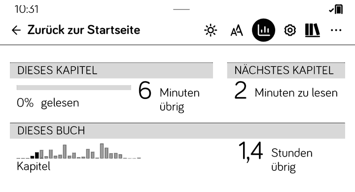
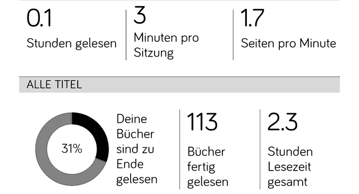

<div align="center">

# NickelReadingStats

**Kobos Lesestatistik auf dem Tolino, auch für eigene EPUBs.**

[](https://github.com/dkuester/NickelReadingStats/releases/latest)
[](https://github.com/dkuester/NickelReadingStats/actions/workflows/ci.yml)
[-informational)](#kompatibilität)
[](LICENSE)

[Installation](#installation) · [Funktionen](#funktionen) · [Datenschutz](#datenschutz) · [Funktionsweise](docs/ARCHITECTURE.md) · [Entwicklung](docs/DEVELOPMENT.md) · [Releases](https://github.com/dkuester/NickelReadingStats/releases) · [English](README.md)

</div>

Tolino-Reader laufen mit derselben Software wie Kobo-Geräte, doch Kobos
„Lesestatistik“ ist auf ihnen abgeschaltet und funktioniert selbst auf einem
Kobo nur für kepub-Dateien. NickelReadingStats ist ein
[NickelHook](https://github.com/pgaskin/NickelHook)-Mod, der sie wieder
einschaltet, auf normale EPUBs erweitert und dabei dafür sorgt, dass dein
Tolino ein Tolino bleibt: Shop, Cloud, DRM und Datenschutz verhalten sich wie
bisher.

> [!IMPORTANT]
> **Noch auf v0.1.0 oder v0.2.0? Bitte auf das [neueste Release](https://github.com/dkuester/NickelReadingStats/releases/latest) aktualisieren.**
> In diesen Versionen lief auf dem Tolino Kobos Analytics-Erfassung mit, und
> Leseereignisse konnten an Google übertragen werden. Ab v0.2.1 ist das
> unterbunden, und noch nicht gesendete Einträge werden gelöscht. Siehe
> [Datenschutz](#datenschutz).

---

## Funktionen

| Funktion | Beschreibung |
|---|---|
| **Buchstatistik** | Eigene Seite im Lesemenü mit Kapitelbalken. Gelesene Kapitel sind hervorgehoben, dazu gibt es Restzeit-Schätzungen. |
| **Aktivität** | Eintrag „Aktivität“ im Mehr-Menü: Stunden gelesen, Minuten pro Sitzung, Seiten pro Minute. |
| **Normale EPUBs** | Funktioniert für eigene EPUBs und im Tolino-Shop gekaufte Bücher, nicht nur für kepubs. Die Wortzahlen werden im Hintergrund berechnet und pro Buch zwischengespeichert. |
| **Tolino bleibt Tolino** | Kobo-Verhalten wird nur für die wenigen Funktionen freigegeben, die Lesezeit und Seitenwechsel aufzeichnen. Thalia-Konto (oder das eines anderen Buchhändlers), Sync und Downloads bleiben unberührt. |
| **Datenschutz** | Kobos Analytics und Google Analytics sind auf dem Tolino stillgelegt. |
| **Fehlertolerant** | Jeder Hook ist optional und fällt sauber weg: Passt etwas nicht zur Firmware, fehlt eine Statistik, nicht das gewohnte Verhalten deines Geräts. |

<p align="center">
  
  
</p>
<p align="center"><sub>Buchstatistik im Lesemenü (links) und Seite „Aktivität“ (rechts) auf einem Tolino mit Firmware 5.18.</sub></p>

## Kompatibilität

| Gerät / Firmware | Status |
|---|---|
| Tolino, Firmware 5.18+ (Qt 6) | ✅ Getestet (5.18.264769) |
| Kobo, Firmware 5.18 / 6.0 (Qt 6) | ⚠️ Symbolgeprüft (5.18.270971, 6.0.276679), auf Gerät ungetestet |
| Kobo / Tolino, Firmware 4.x (Qt 5) | ❌ Nicht unterstützt |

| Inhalt | Statistik |
|---|---|
| Eigenes EPUB (`.epub`) | ✅ Durch diesen Mod ergänzt |
| Tolino-Shop-Buch (EPUB mit Wasserzeichen) | ✅ Durch diesen Mod ergänzt |
| Tolino-Shop-Buch mit DRM (Adobe, verschlüsselt) | ⚠️ Nur Aktivität: keine Kapitelbalken, keine Restlesezeit |
| kepub (`.kepub.epub`, Kobo-Shop-Bücher) | ✅ Unverändert, wie von Nickel bereitgestellt |
| Fixed-Layout-EPUB, reine Bilderbücher, PDF, Comics | ❌ Ausgeschlossen, wie es Nickel auch bei kepubs tut |

## Installation

> [!TIP]
> NickelMenu oder andere Mods sind nicht nötig. NickelReadingStats bringt sein
> eigenes Hook-Framework mit.

1. `Kobo.tgz` aus dem [neuesten Release](https://github.com/dkuester/NickelReadingStats/releases/latest) herunterladen.
2. Das Gerät per USB verbinden und `Kobo.tgz` in den versteckten Ordner
   `.kobo/` kopieren.
3. Das Gerät auswerfen. Es spielt das Update beim nächsten Start ein; startet
   es nicht von selbst neu, bitte neu starten.

Ein eigenes EPUB öffnen und der Wortzählung einen Moment geben. Danach
erscheint die Buchstatistik im Lesemenü und „Aktivität“ im Mehr-Menü.
Gelesene Stunden und Seiten pro Minute füllen sich erst, nachdem du eine
Weile gelesen hast.

**Aktualisieren:** Das neuere `Kobo.tgz` genauso kopieren; vorher
deinstallieren ist nicht nötig.

**Deinstallieren:** Im Hauptverzeichnis des Geräts eine leere Datei namens
`readingstats_uninstall` (ohne Dateiendung) anlegen und neu starten. Der Mod
entfernt sich selbst, und das Gerät verhält sich wieder wie im
Auslieferungszustand.

## Datenschutz

Kobos Reading-Life-Code, den die Statistik braucht, enthält auch Kobos
Analytics. Ein Tolino ohne Mod führt ihn nie aus. NickelReadingStats lässt den
Statistik-Teil laufen und hält den Analytics-Teil auf dem Tolino still:

| | Tolino ohne Mod | Mit NickelReadingStats ab 0.2.1 |
|---|---|---|
| Lesestatistik auf dem Gerät gespeichert | — | ✅ |
| Analytics-Ereignisse (`KoboReader.sqlite`) | keine | keine (verworfen) |
| Google-Analytics-Warteschlange (`.kobo/Kobo/Analytics.conf`) | keine | keine (stillgelegt, alte Einträge gelöscht) |

Die Statistik bleibt auf dem Gerät. Auf einem Kobo verhalten sich Analytics
genau wie ohne Mod. Details (englisch):
[Privacy internals](docs/ARCHITECTURE.md#privacy-internals).

## Bekannte Einschränkungen

- Verschlüsselte (DRM-geschützte) Bücher lassen sich nicht auszählen: Dazu
  müsste der Mod den Kopierschutz umgehen, und das tut er nicht. Lesezeit,
  Sitzungen und Seiten pro Minute werden für diese Bücher trotzdem erfasst,
  die Buchstatistik zeigt aber keine Kapitelbalken und keine Restlesezeit.
  Shop-Bücher mit Wasserzeichen sind nicht verschlüsselt und werden voll
  unterstützt.
- Die Restzeit-Schätzung kann zu niedrig ausfallen, sogar „0 Minuten“, bis
  Nickel deine Lesegeschwindigkeit aus ein paar längeren Sitzungen gelernt
  hat. Nickel aktualisiert die Geschwindigkeit erst, wenn ein Buch erneut
  geöffnet wird.
- Ein Buch, das aus einer einzigen großen HTML-Datei besteht, zeigt nur einen
  Kapitelbalken.
- Die Buchstatistik erscheint einen Moment nach dem Öffnen eines Buchs, sobald
  die Wortzählung im Hintergrund fertig ist.
- Auf einem Kobo-Gerät ist der Mod noch nicht getestet. Die Firmware-Prüfung
  (Symbole, Aufrufkonventionen, Klassenlayout, Offsets) ist für Kobo
  5.18.270971 und 6.0.276679 grün. Wer einen Kobo hat: Feedback ist sehr
  willkommen.

## Funktionsweise

Auf dem Tolino ist die Statistik hinter mehreren Abfragen von
`Device::isTolino()` und einer kepub-only-Regel versteckt. Der Mod hookt diese
Funktionen in `libnickel.so.1.0.0`, antwortet „kein Tolino“ nur den fünf
Kobo-Reading-Life-Funktionen, die das brauchen, zählt die Wörter für normale
EPUBs selbst und legt Kobos Analytics still. Die vollständige Beschreibung mit
allen Hooks und dem Aufrufgraphen steht (englisch) in
[docs/ARCHITECTURE.md](docs/ARCHITECTURE.md).

## Entwicklung

```sh
git clone --recurse-submodules https://github.com/dkuester/NickelReadingStats.git
cd NickelReadingStats/hook
docker run --rm --volume="$PWD:$PWD" --workdir="$PWD" ghcr.io/dkuester/nickelstorygraph-toolchain 'make kobo'
make -C tests check            # Host-Unit-Tests
```

Jeder Tag `v*` baut `Kobo.tgz` in der CI und veröffentlicht es als
Release. Bauen, die Teststufen, die Firmware-Prüfungen für Symbole und ABI sowie die CI
sind (englisch) in [docs/DEVELOPMENT.md](docs/DEVELOPMENT.md) beschrieben.

## Support

| | |
|---|---|
| Fehlermeldungen und Fragen | [Issues](https://github.com/dkuester/NickelReadingStats/issues). Bitte Gerätemodell, Firmware-Version (`.kobo/version`) und Mod-Version angeben. |
| Downloads und Änderungen | [Releases](https://github.com/dkuester/NickelReadingStats/releases) |
| Frühere Historie | Issues und Pull-Requests bis v0.2.1 liegen im [archivierten Codeberg-Repo](https://codeberg.org/hortizept/nickel-reading-stats). |
| Mitwirken | Pull-Requests gegen `main`; die CI muss grün sein. Siehe [docs/DEVELOPMENT.md](docs/DEVELOPMENT.md). |

> [!WARNING]
> Dieser Mod verändert das Verhalten der Software deines E-Readers. Er steht in
> keiner Verbindung zu Kobo, Rakuten oder der Tolino-Allianz. Nutzung auf
> eigene Gefahr.

## Danksagung

Der Mod steht auf den Schultern von:

- **[NickelHook](https://github.com/pgaskin/NickelHook)** (MIT, © 2020–2025
  Patrick Gaskin): das Hook-Framework, verwendet in der `qt6-support`-Fork von
  **Nico Verbruggen** ([nicoverbruggen/NickelHook](https://github.com/nicoverbruggen/NickelHook)),
  die Qt-6-Unterstützung ergänzt.
- **Qt 6.5.2** (The Qt Project / The Qt Company): `QZipReader` (private API,
  LGPL-3.0/GPL-2.0/GPL-3.0) zum Lesen der EPUBs sowie `QXmlStreamReader` und
  `QRegularExpression`.
- **Toolchain-Image** [`ghcr.io/dkuester/nickelstorygraph-toolchain`](https://github.com/dkuester/NickelStorygraph/pkgs/container/nickelstorygraph-toolchain)
  aus NickelStorygraph: die Docker-Cross-Compile-Toolchain
  (`arm-kobo-linux-gnueabihf`, GCC 11.5, Qt 6.5.2), aufbauend auf
  [pgaskin/NickelTC](https://github.com/pgaskin/NickelTC).
- **Kobo/Tolino-Firmware** (`libnickel.so.1.0.0`; Tolino 5.18, Kobo 5.18 und 6.0): das Ziel-Binary.
  Die internen Klassen (`Device`, `ReadingView`, `Content`, `EventEngine`)
  wurden per Symbolanalyse und Capstone-Disassembly reverse-engineered.

## KI-Unterstützung

Dieser Mod wurde mit Hilfe von KI-Assistenten reverse-engineered und gebaut.
Die Analyse der Firmware-Sperren, das Disassemblieren und die erste
Implementierung entstanden mit Hermes Agent (Nous Research). Das Code-Review,
die Härtung und die Datenschutz-Korrekturen in v0.2.x entstanden mit Claude
Code (Anthropic). Fachliche Kontrolle, Tests auf dem Gerät und Freigabe lagen
bei einem Menschen.

## Lizenz

[MIT](LICENSE)
