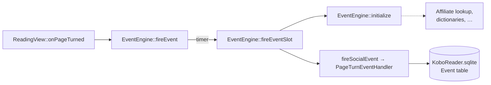

# How NickelReadingStats works

This document describes the internals: which firmware gates hide the reading
stats, which functions the mod hooks, and how it keeps Tolino-specific
behaviour (store, cloud, DRM, privacy) intact. For installation and usage see
the [README](../README.md); for building and testing see
[DEVELOPMENT.md](DEVELOPMENT.md).

All symbol names, offsets and call structures refer to the Tolino 5.18
`libnickel.so.1.0.0` (Qt 6.5.2) and are verified by `tools/check-symbols.py`.

## Contents

- [The gates](#the-gates)
- [Hooks](#hooks)
- [Kobo mode, scoped to the gates](#kobo-mode-scoped-to-the-gates)
- [Which books get stats](#which-books-get-stats)
- [Word counting for regular EPUBs](#word-counting-for-regular-epubs)
- [Privacy internals](#privacy-internals)
- [Robustness](#robustness)

## The gates

Kobo and Tolino share one `libnickel.so.1.0.0`; `Device::isTolino()` switches
between them at runtime. The reading stats are held back by several
independent gates:

| # | Gate | Effect on a Tolino / for plain EPUBs |
|---|---|---|
| 1 | `Device::supportsReadingLife()` returns `!isTolino()` | The whole Reading Life / stats UI is off on a Tolino. |
| 2 | `Device::supportsActivityInMore()` checks `isTolino()` itself | The "Activity" entry in the More menu stays hidden even with (1) fixed. |
| 3 | `EventEngine::startReadingSession()` / `endReadingSession()` (session time) and `fireEvent()` / `fireEventSlot()` (page turns) return early on a Tolino; `fireEventSlot()` also needs `EventEngine::initialize()`, which refuses on a Tolino | The Activity metrics stay at 0. |
| 4 | `ReadingView::supportsReadingStats()` accepts kepubs only, on Kobo too; `hasValidReadingStats()` then requires word counts and `0 <= mergedTOCAndSpineIndex() < wordCounts.size()` | No per-book stats for sideloaded EPUBs. |
| 5 | `ReadingView::updateWordCounts()` counts words for kepubs only; `mergedTOCAndSpineIndex()` is never computed for plain EPUBs | Chapter bars and time estimates stay empty. |

## Hooks

| Hook | Symbol | Effect |
|---|---|---|
| `Device::supportsReadingLife()` | `_ZNK6Device19supportsReadingLifeEv` | Re-enable the feature on Tolino |
| `Device::supportsActivityInMore()` | `_ZNK6Device22supportsActivityInMoreEv` | Show the "Activity" entry in the More menu on Tolino |
| `Device::isTolino()` | `_ZNK6Device8isTolinoEv` | Report "not Tolino" only to the gate functions while they run (see below) |
| `EventEngine::startReadingSession()` | `_ZN11EventEngine19startReadingSessionE…` | Run the Kobo session-start path on Tolino |
| `EventEngine::endReadingSession()` | `_ZN11EventEngine17endReadingSessionE…` | Run the Kobo session-end path on Tolino |
| `EventEngine::fireEvent()` | `_ZN11EventEngine9fireEventEPKcRK6Vol…` | Run the page-turn event entry on Tolino |
| `EventEngine::fireEventSlot()` | `_ZN11EventEngine13fireEventSlotE10QByt…` | Record page turns/events on Tolino (pages per minute) |
| `EventEngine::fireAnalyticsEvent()` | `_ZN11EventEngine18fireAnalyticsEvent…` | Drop analytics events on Tolino |
| `GoogleAnalyticsRequester::apiRequest/sendRequest/loadQueue()` | `_ZN24GoogleAnalyticsRequester…` | Silence Kobo's Google Analytics on Tolino |
| `ReadingView::supportsReadingStats()` | `_ZNK11ReadingView20supportsReadingStatsEv` | Allow stats for regular EPUBs |
| `ReadingView::updateWordCounts()` | `_ZN11ReadingView16updateWordCountsEv` | Retrofit word counting for regular EPUBs |
| `ReadingView::mergedTOCAndSpineIndex()` | `_ZN11ReadingView22mergedTOCAndSpineIndexEv` | Use the raw spine index so read chapters are highlighted |
| `FeatureSettings::bookSpecificStatsEnabled()` | `_ZN15FeatureSettings24bookSpecificStatsEnabledEv` | Force per-book stats on |

Every hook calls the original function first and keeps a positive answer, so
kepubs and Kobo behaviour are unchanged. On a Kobo (`isTolino()` false) the
Tolino-specific hooks pass through.

`hasValidReadingStats()` is deliberately **not** hooked: it calls
`supportsReadingStats()` and `mergedTOCAndSpineIndex()` through the PLT, i.e.
through the hooks above, so its range check passes for plain EPUBs once the
word counts are in, and it still guards against stats on an empty or
misaligned list.

## Kobo mode, scoped to the gates

The three Activity metrics ("hours read", "minutes per session", "pages per
minute") are fed by the reading-session tracking and the page-turn events.
Those functions check `isTolino()` internally and skip the entire Kobo
recording on a Tolino.

While the hook runs those functions, `isTolino()` returns `false` only when
all three conditions hold:

1. on the calling thread (a `thread_local` flag),
2. for the duration of the call (`ForceKoboScope`, RAII),
3. and only when it is called **directly** from one of the five gate functions
   `startReadingSession`, `endReadingSession`, `fireEvent`, `fireEventSlot`
   and `initialize`, recognised by the return address. The gate code ranges
   come from the dynamic symbol table (`dladdr1`, `st_size`) at startup.

Everything else keeps the real value: other threads, the Tolino
store/cloud/DRM, and everything the gates call further down. On 5.18 that
includes the affiliate lookup (Thalia vs. Kobo) and the dictionary list below
`EventEngine::initialize()` (dotted in the diagram). A gate that cannot be
resolved keeps the Tolino path, so the failure mode is a missing statistic,
never a leak.

`initialize()` is a gate because `fireEventSlot()` calls it on every event and
needs it to report "initialised", which it only does on its non-Tolino branch.

`tools/check-symbols.py` verifies that each gate calls `isTolino()` itself with
`bl`/`blx`, and that no gate calls a function that reaches `isTolino()` by a
tail call (its return address would also lie in the gate).

**The Activity entry:** `supportsActivityInMore()` returns `false` on a Tolino
because of `isTolino()`, independently of `supportsReadingLife()`. The hook
re-runs the original check (`!isTolino() && deviceClass == 2 &&
!ParentalControl`) but drops only the `isTolino()` gate; the device-class and
parental-control guards remain and fail closed.

## Which books get stats

The hooks call the original `supportsReadingStats()` first and keep a `true`.
Otherwise they apply the original rule with only its kepub requirement
replaced by "plain EPUB" (`application/epub+zip`):

- the content's accessibility state must not be 6,
- the book must not consist of images only (`hasOnlyImages()`, the virtual
  call at vtable slot `0x10c` in the original),
- and it must not be fixed-layout.

Fixed-layout content (fixed-layout EPUBs, PDFs, comics), image-only books and
other formats stay excluded, and a kepub that Nickel rejects stays rejected.

## Word counting for regular EPUBs

`ReadingView::updateWordCounts()` is the kepub-only gate that produces the
per-chapter word counts behind the chapter bars and the "time left" estimate.
The hook calls the original first (kepub and Instapaper run unchanged), then
counts the words for a sideloaded EPUB itself:

1. Check the MIME type (`application/epub+zip`) and exclude fixed-layout.
2. Derive the EPUB file path from the content ID (`file://…`).
3. Open the EPUB with `QZipReader`, locate the OPF
   (`META-INF/container.xml`, fallback `*.opf`) and parse the spine order.
4. For each spine file, decode the XHTML (UTF-8, or UTF-16 by BOM), count only
   the `<body>`, drop comments, scripts and styles, and count tokens that
   contain a letter or digit.
5. Deliver one count per spine item (missing or oversized files count as 0,
   so indices stay aligned) via `ReadingView::gotWordCounts()`.

Steps 3–4 run on a single background thread, like Nickel's own kepub word
counter, so opening a book never blocks the UI. The result is delivered on the
GUI thread, only if the view still exists and still shows the same book.
Results are cached per file (invalidated when size or mtime change), and each
zip entry is capped at 8 MB uncompressed.

`mergedTOCAndSpineIndex()` falls back to the raw spine `chapterIndex()` for
plain EPUBs, so the chapters already read are highlighted. A book made of a
single large HTML file yields exactly one bar; that is correct, not an empty
view.

## Privacy internals

Opening Kobo's reading-life paths on a Tolino also opens Kobo's analytics.
Measured on Tolino 5.18:

| Channel | Without the mod | With v0.1.0/v0.2.0 | Since v0.2.1 |
|---|---|---|---|
| `AnalyticsEvents` table (`KoboReader.sqlite`) | nothing queued | `OpenContent`/`leave_content` with title, author, ISBN, reading time | dropped (`fireAnalyticsEvent`) |
| Google Analytics queue (`.kobo/Kobo/Analytics.conf` → `ssl.google-analytics.com`) | requester never created | reading events, screens, battery, book IDs (v0.2.0) | silenced (`apiRequest`, `sendRequest`, `loadQueue`) |

The Google Analytics requester is created by `EventEngine::initialize()`,
which the stats need. Its hits bypass `fireAnalyticsEvent()`, so it is
silenced at three points: no new hit, no upload, and the persisted queue is
not restored, so the next save empties it. The decision uses the real
`isTolino()` value recorded by the hook; while unknown, hits are dropped. On a
Kobo, analytics are left alone.

The reading-life data behind the stats is stored on the device
(`Event` table) and is not affected.

## Robustness

"Robust" here means: degrade gracefully, never crash.

- Every hook and `dlsym` target is optional: if a 5.18+ build lacks a symbol,
  only the feature that needs it is lost (NickelHook logs each unresolved
  symbol).
- Checks that cannot be evaluated fail closed: no stats, no Activity entry, no
  analytics.
- Firmware-specific assumptions (return conventions, the `ReadingView` →
  `Content` offset `0x94`, `ReadingView`'s primary base `QWidget` at offset 0,
  the virtual call in `supportsReadingStats()`, the gate functions) are
  checked by `tools/check-symbols.py`; see [DEVELOPMENT.md](DEVELOPMENT.md).
